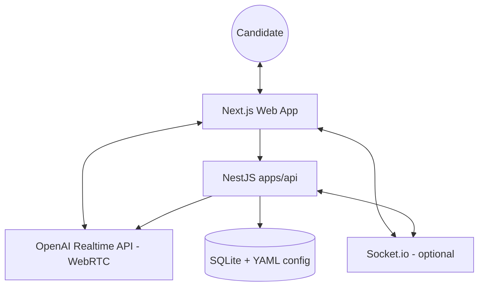

# Architecture & developer guide

This document describes the technical architecture after the LiveKit decoupling: **direct browser ↔ OpenAI Realtime WebRTC**, a NestJS API for secrets and data, and optional Socket.io for multi-tab use.

## High-level architecture

### Session flow (summary)

1. The browser calls `POST …/exam/session/create` (body typed via `@yorty-tcf/shared`).
2. The API loads YAML + SQLite exercise data, calls `POST /v1/realtime/client_secrets`, and returns `clientSecret`, exercise payload, and agent config (instructions, greeting, model, voice).
3. The client creates a `RealtimeSession` (`@openai/agents/realtime`) with WebRTC transport; tools `finSession` and `envoiRapport` run **in the browser** and drive the UI.
4. Report streaming uses transport events (partial `function_call` for `envoiRapport`) plus completion when the tool runs.
5. Socket.io (`EventsGateway`) can join room `session:{id}` for future multi-device events.

---

## Web (`apps/web`)

- **Provider**: `providers/realtime-exam-provider.tsx` — Realtime agent, `getUserMedia`, connection, transcripts, streamed report.
- **Session UI**: `components/app/session-view.tsx`, `view-controller.tsx`, tabs for conversation / brief / tips.
- **UI primitives**: `components/ui/*` (ex-shadcn, no LiveKit dependency).

Environment: see `apps/web/.env.example` (`NEXT_PUBLIC_EXAM_API_URL`).

---

## API (`apps/api`)

- **Bootstrap**: `src/main.ts` — CORS (`CORS_ORIGINS`), `PORT` (default 3001), Socket.io adapter.
- **Exam session**: `src/session/` — OpenAI `client_secret` minting and config/exercise assembly.
- **Data**: `src/exercise/exercise.service.ts` (SQLite, `config/tcf-exercises.db`), `src/config/exam-config.service.ts` (YAML under `apps/api/config/`).
- **HTTP contract**: oRPC procedure exposed as `POST /exam/session/create` (`src/contract/`, `src/exam/`).
- **Paths**: `src/paths.ts` resolves `apps/api/config` when `cwd` is the monorepo root (Docker).

Environment: see `apps/api/.env.example` (`OPENAI_API_KEY`, `PORT`, `CORS_ORIGINS`). Optional: `OPENAI_REALTIME_MODEL` overrides the concrete Realtime model when `service.yml` sets `llm.model` to `realtime` (see `ExamSessionService.resolveRealtimeModel`).

TEF/TCF content scripts (run from `apps/api`): `generate-db`, `rename-tef`, `generate-tef-instructions`, `sync-tef` — see `apps/api/package.json`.

---

## Shared package (`packages/shared`)

Source of truth for:

- `TaskType` and task lists.
- Zod schemas / types `CreateExamSessionInput` | `CreateExamSessionOutput`, `ExerciseImagePayload`.
- Socket.io events: `SOCKET_EVENTS` and typed payloads.
- Legacy types `DataMessage` / `ParticipantMetadata` (historical LiveKit protocol, still exported for reference or tooling).

**Build**: the package emits JS to `dist/`; run `pnpm build` at the root or `pnpm --filter @yorty-tcf/shared build` before strict typed consumption.

---

## Railway deployment

- **Services**: only **api** (`apps/api/railway.json`) and **web** (`apps/web/railway.json`). There is **no** Railway “agent” service: the Realtime session (`@openai/agents/realtime`, WebRTC) runs in the **browser**; the API supplies `client_secret`, exercises, and config (instructions, greeting, etc.).
- **Root directory**: empty (monorepo root) for both services.
- **API**: `OPENAI_API_KEY`; `CORS_ORIGINS` = public web URL(s); `PORT` from Railway if provided.
- **Web**: `NEXT_PUBLIC_EXAM_API_URL` = public **HTTPS** API URL at **build** time (client bundle uses this base for `POST /exam/session/create`, etc.).
- **Practical order**: deploy API → set URL in Web build → set `CORS_ORIGINS` on the API to the Web URL.

Local Docker details: [DOCKER.md](./DOCKER.md). Variable tables: **Railway** section in [README.md](./README.md).

## pnpm commands

Per-package script reference: [README.md](./README.md). For the API: `pnpm --filter @yorty-tcf/api <script>`.
