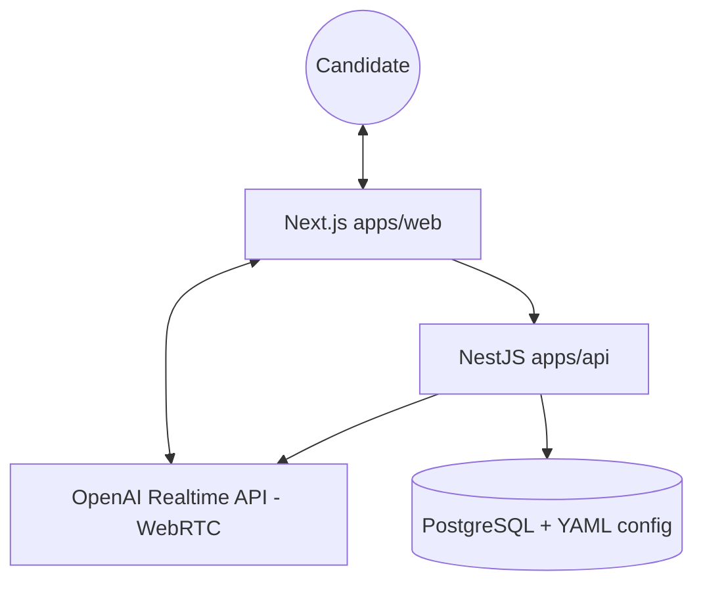

# Architecture & developer guide

parle-tcf covers **only the TCF speaking test** (Tâches 1 to 3). Voice is **direct browser ↔ OpenAI Realtime over WebRTC**; a NestJS API mints the ephemeral secret and serves prompts and exercises.

## High-level architecture

### Session flow

1. The browser calls `POST …/exam/session/create` (input and output typed by `@parle-tcf/shared`).
2. The API loads the task YAML and the exercise (PostgreSQL), decrypts the signed-in user's own API key, calls `POST /v1/realtime/client_secrets`, and returns `clientSecret`, the exercise payload and the agent config (instructions, greeting, model, voice).
3. The client creates a `RealtimeSession` (`@openai/agents/realtime`) over WebRTC. The tools `finSession`, `envoiRapport` and `recommencerTest` run **in the browser** and drive the UI.
4. The report streams from transport events (partial `function_call` for `envoiRapport`) and is final when the tool runs. Nothing is persisted server-side yet.

---

## Web (`apps/web`)

- **Provider**: `providers/realtime-exam-provider.tsx` — Realtime agent, `getUserMedia`, connection, transcripts, streamed report.
- **Session UI**: `components/app/session-view.tsx`, `view-controller.tsx`, tabs for consigne / conseils / conversation.
- **Routes**: `/` redirects to `/tcf`; `/tcf/{tache1|tache2|tache3}/{exerciseId?}`.
- **UI primitives**: `components/ui/*` (shadcn).

Environment: see `apps/web/.env.example` (`NEXT_PUBLIC_EXAM_API_URL`).

---

## API (`apps/api`)

- **Bootstrap**: `src/main.ts` — CORS (`CORS_ORIGINS`), `PORT` (default 3001).
- **Exam session**: `src/session/` — OpenAI `client_secret` minting and config/exercise assembly.
- **Data**: `src/exercise/exercise.service.ts` (Drizzle, table `exercises`; schema in `packages/db`), `src/config/exam-config.service.ts` (YAML and markdown under `apps/api/config/`).
- **HTTP contract**: oRPC procedure exposed as `POST /exam/session/create` (`src/contract/`).
- **Paths**: `src/paths.ts` resolves `apps/api/config` when `cwd` is the monorepo root (Docker).

Environment: see `apps/api/.env.example` (`OPENAI_API_KEY`, `PORT`, `CORS_ORIGINS`). Optional: `OPENAI_REALTIME_MODEL` overrides the Realtime model when `service.yml` sets `llm.model` to `realtime` (see `ExamSessionService.resolveRealtimeModel`).

Content script: `pnpm --filter @parle-tcf/db db:seed` upserts `config/tcf-exercises.csv` into PostgreSQL (idempotent).

---

## Shared package (`packages/shared`)

Source of truth for:

- `TaskType` (`tache1 | tache2 | tache3`) and `TCF_TASK_TYPES`.
- Zod schemas and types `CreateExamSessionInput`, `CreateExamSessionOutput`, `ExerciseData`.

**Build**: the package emits CommonJS to `dist/`; run `pnpm build` at the root or `pnpm --filter @parle-tcf/shared build` before consuming it.

---

## Railway deployment

- **Services**: **api** (`apps/api/railway.json`) and **web** (`apps/web/railway.json`). The Realtime session runs in the **browser**; the API supplies `client_secret`, exercises and config.
- **Root directory**: empty (monorepo root) for both services.
- **API**: `OPENAI_API_KEY`; `CORS_ORIGINS` = public web URL(s); `PORT` from Railway if provided.
- **Web**: `NEXT_PUBLIC_EXAM_API_URL` = public **HTTPS** API URL at **build** time.
- **Order**: deploy API → set its URL in the Web build → set `CORS_ORIGINS` on the API to the Web URL.

Local Docker details: [DOCKER.md](./DOCKER.md). Variable tables: **Railway** section in [README.md](./README.md).

## pnpm commands

Per-package script reference: [README.md](./README.md). For one package: `pnpm --filter @parle-tcf/<api|web|shared> <script>`.
