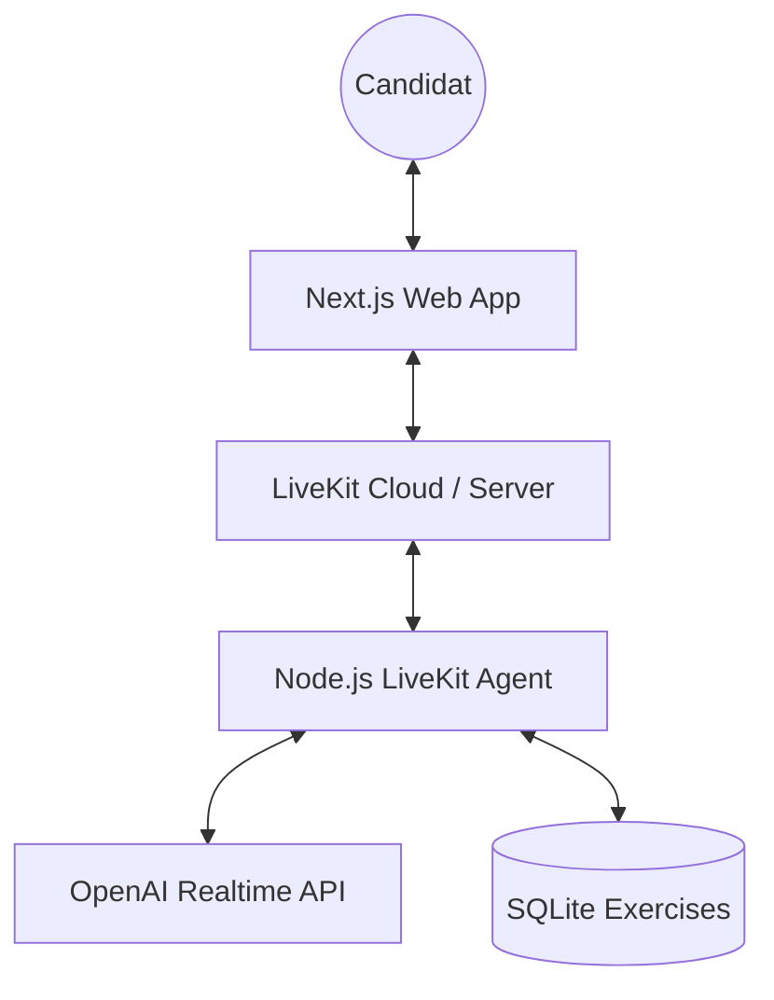

# 🏗️ Architecture & Developer Guide

Ce guide approfondit l'architecture technique de la plateforme TCF/TEF LiveKit. Il est destiné aux développeurs souhaitant comprendre le fonctionnement interne et commencer à contribuer.

## 🗺️ Architecture de Haut Niveau

Le système suit une architecture classique Realtime Voice AI utilisant LiveKit comme couche d'orchestration.



### 🏎️ Stratégie de Réveil (Scale-to-Zero)
Pour optimiser les coûts sur Railway, l'agent se met en veille lorsqu'il n'est pas utilisé. Nous utilisons une stratégie de réveil à deux niveaux :

1.  **Niveau B (Eager)** : Le layout racine de l'application web lance un `POST /wake` non bloquant à chaque chargement de page.
2.  **Niveau A (Safety)** : La route API `connection-details` effectue un appel de réveil **bloquant** avant de générer le jeton LiveKit. Cela garantit que l'agent est en train de démarrer avant que l'utilisateur n'essaie de se connecter.

---

## 🤖 Focus Agent (`apps/agent`)

### Point d'Entrée : `src/agent.ts`
Lorsqu'un travailleur LiveKit démarre, il exécute le code dans `agent.ts`.
1.  **Serveur HTTP** : Démarre un serveur léger (`wake-server.ts`) sur le port 8080 pour les healthchecks et les appels de réveil.
2.  **Définition de l'Agent** : Se connecte à la salle et **attend un participant**.
3.  **Poignée de Main de Métadonnées** : Une fois qu'un participant rejoint, l'agent lit ses `metadata` (définies par l'application web lors de la génération du jeton) pour identifier le `taskType` (ex: `tache2`).
4.  **Instanciation de la Tâche** : Il crée une instance spécifique (ex: `TCFTache2`) qui hérite de la base `TCFAgent`.

### Logique de Tâche : `src/agents/TCFAgent.ts`
La classe `TCFAgent` est le cœur du comportement de l'examinateur :
- **Configuration YAML** : Charge les instructions, les salutations et les contraintes à partir de `config/agents/*.yml`.
- **Chargement d'Exercices** : Si la tâche l'exige, il extrait le contenu de l'exercice de la base de données SQLite.
- **Outils LLM** : Définit des outils comme `finSession` (pour arrêter l'examen) et `envoiRapport` (pour envoyer le rapport pédagogique).
- **Messagerie de Données** : Communique avec le client web en utilisant le protocole personnalisé défini dans `@yorty-tcf/shared`.

### Cycle de Vie d'une Session
```mermaid
sequenceDiagram
    participant W as Web App
    participant A as Agent
    participant L as LLM (OpenAI)
    
    W->>A: Rejoindre la Salle (avec Métadonnées de Tâche)
    A->>W: Envoyer les Données d'Exercice (Titre, Desc, Image)
    A->>W: Salutation Orale (Audio)
    Note over W,A: Phase d'Examen
    W<->A: Échange Audio Temps Réel
    A->>L: Contexte + Instructions
    L->>A: Réponse
    A->>W: Audio + Transcription
    Note over A: Fin d'Examen Déclenchée
    A->>W: Envoyer Message 'session_end'
    A->>L: Requête de Génération de Rapport
    L->>A: Rapport Markdown
    A->>W: Envoyer Messages de Données 'report' (Chunked)
    Note over W,A: Phase de Coaching
```

---

## 📦 Focus Shared Package (`packages/shared`)

Ce paquet est la "Source de Vérité" pour tout le monorepo. Il contient :
- `TaskType` : Type d'union pour tous les examens supportés.
- `DataMessage` : Union discriminée pour tous les messages de données.
- `ParticipantMetadata` : Structure des métadonnées passées dans les jetons.

---

## 🚀 Déploiement sur Railway (Recommandé)

Le déploiement est optimisé pour Railway :
- Deux services : `web` et `agent`.
- **Root Directory** : Laissez vide dans les paramètres Railway.
- **Config Paths** : Pointe vers `apps/agent/railway.json` et `apps/web/railway.json`.
- **Variables d'Environnement** : Doivent être définies dans le tableau de bord Railway.

Pour plus de détails sur Docker et l'hébergement local, consultez [DOCKER.md](./DOCKER.md).

## Commandes npm / pnpm

La liste complète des scripts (racine, `@yorty-tcf/agent`, `@yorty-tcf/web`) et la syntaxe `pnpm --filter` sont documentées dans [README.md](./README.md) (section **Référence des commandes par paquet**).
