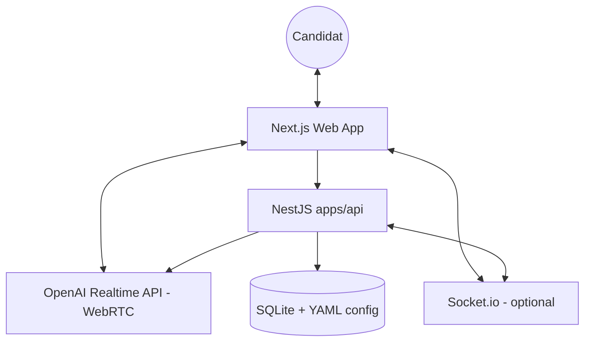

# 🏗️ Architecture & Developer Guide

Ce guide décrit l’architecture technique de la plateforme TCF/TEF après le découplage LiveKit : **WebRTC direct navigateur ↔ OpenAI Realtime**, API NestJS pour secrets & données, Socket.io optionnel pour le multi-onglet.

## 🗺️ Architecture de Haut Niveau

### Flux session (résumé)

1. Le navigateur appelle `POST …/exam/session/create` (corps typé via `@yorty-tcf/shared`).
2. L’API charge YAML + exercice SQLite, appelle `POST /v1/realtime/client_secrets`, renvoie `clientSecret`, données d’exercice et config agent (instructions, greeting, modèle, voix).
3. Le client crée un `RealtimeSession` (`@openai/agents/realtime`) avec transport WebRTC ; les outils `finSession` et `envoiRapport` s’exécutent **dans le navigateur** et mettent à jour l’UI.
4. Le streaming du rapport repose sur les événements transport (`function_call` partiel pour `envoiRapport`) + finalisation à l’exécution de l’outil.
5. Socket.io (`EventsGateway`) permet de rejoindre une room `session:{id}` pour des événements futurs multi-appareils.

---

## 🌐 Focus Web (`apps/web`)

- **Provider** : `providers/realtime-exam-provider.tsx` — agent Realtime, micro `getUserMedia`, connexion, transcripts, rapport streamé.
- **UI session** : `components/app/session-view.tsx`, `view-controller.tsx`, onglets conversation / consigne / conseils.
- **Composants UI** : `components/ui/*` (ex-shadcn, sans dépendance LiveKit).

Variables utiles : voir `apps/web/.env.example` (`NEXT_PUBLIC_EXAM_API_URL`).

---

## 🔧 Focus API (`apps/api`)

- **Bootstrap** : `src/main.ts` — CORS (`CORS_ORIGINS`), port `PORT` (défaut 3001), adaptateur Socket.io.
- **Session exam** : `src/session/` — création de `client_secret` OpenAI + assemblage config / exercice.
- **Données** : `src/exercise/exercise.service.ts` (SQLite, `config/tcf-exercises.db`), `src/config/exam-config.service.ts` (YAML sous `apps/api/config/`).
- **Contrat HTTP** : procedure oRPC exposée en `POST /exam/session/create` (`src/contract/`, `src/exam/`).
- **Chemins fichiers** : `src/paths.ts` résout `apps/api/config` même quand `cwd` est la racine du monorepo (Docker).

Variables : voir `apps/api/.env.example` (`OPENAI_API_KEY`, `PORT`, `CORS_ORIGINS`).

Scripts contenu TEF/TCF (exécutés depuis `apps/api`) : `generate-db`, `rename-tef`, `generate-tef-instructions`, `sync-tef` — voir `apps/api/package.json`.

---

## 📦 Paquet Shared (`packages/shared`)

Source de vérité pour :

- `TaskType`, listes de tâches.
- Schémas Zod / types `CreateExamSessionInput` | `CreateExamSessionOutput`, `ExerciseImagePayload`.
- Événements Socket.io : `SOCKET_EVENTS`, payloads typés.
- Types legacy `DataMessage` / `ParticipantMetadata` (protocole LiveKit historique, encore exportés pour référence ou outils).

**Build** : le paquet émet du JS dans `dist/` ; `pnpm build` à la racine ou `pnpm --filter @yorty-tcf/shared build` avant consommation typée stricte.

---

## 🚀 Déploiement Railway

- **Services** : uniquement **api** (`apps/api/railway.json`) et **web** (`apps/web/railway.json`). Il n’y a **pas** de composant Railway dédié à un « agent » : la session Realtime (SDK `@openai/agents/realtime`, WebRTC) vit dans le **navigateur** ; l’API fournit `client_secret`, exercices et config (instructions, greeting, etc.).
- **Root Directory** : vide (racine du monorepo) pour les deux services.
- **API** : `OPENAI_API_KEY` ; `CORS_ORIGINS` = URL(s) du front public ; `PORT` laissé à Railway si fourni.
- **Web** : `NEXT_PUBLIC_EXAM_API_URL` = URL **HTTPS publique** de l’API au **build** (le bundle client appelle cette base pour `POST /exam/session/create`, etc.).
- **Ordre pratique** : déployer l’API → fixer l’URL dans le build Web → renseigner `CORS_ORIGINS` sur l’API avec l’URL du Web.

Détails Docker local : [DOCKER.md](./DOCKER.md). Variables détaillées : section **Railway** du [README.md](./README.md).

## Commandes pnpm

Référence des scripts par paquet : [README.md](./README.md). Pour l’API : `pnpm --filter @yorty-tcf/api <script>`.
