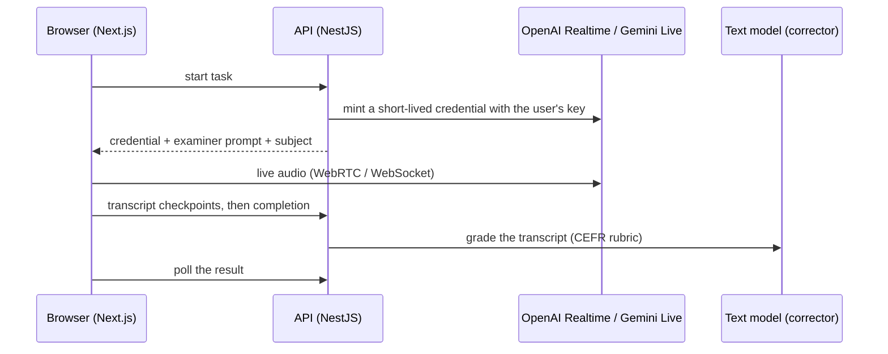

<p align="center">
  
</p>

<h1 align="center">parle-tcf</h1>

<p align="center">
  <strong>Practise the TCF speaking test with an AI examiner, then get a CEFR level, feedback per criterion and your corrected transcript.</strong>
</p>

<p align="center">
  <a href="LICENSE"></a>
  
  
  
  
  
</p>

<p align="center">
  <a href="#features">Features</a> ·
  <a href="#how-it-works">How it works</a> ·
  <a href="#quick-start">Quick start</a> ·
  <a href="docs/README.md">Documentation</a> ·
  <a href="#contributing">Contributing</a>
</p>

parle-tcf simulates the three tasks of the TCF _expression orale_ with official timing. A real-time voice model plays the examiner in the browser (OpenAI Realtime or Gemini Live, with **your own API key**). When a task ends, a separate model grades the transcript on the CEFR scale (A1–C2), explains each criterion and corrects every sentence you said.

> **Not official.** parle-tcf is an independent practice tool. It is not affiliated with, endorsed by, or connected to France Éducation international, and the level it shows is an estimate, not a TCF score.

The app is in French; the code and documentation are in English.

## The three tasks

| Task    | Format                                | Time                  |
| ------- | ------------------------------------- | --------------------- |
| Tâche 1 | Guided interview: introduce yourself  | 2 min                 |
| Tâche 2 | Role play: ask the examiner questions | 2 min prep + 3 min 30 |
| Tâche 3 | Argued opinion on a subject           | 4 min 30              |

Practise one task at a time or take the **full exam** in a row.

## Features

- **Timed like the exam:** each task runs on the official clock, and the examiner closes it when time is up.
- **A realistic examiner** that follows the format: it does not coach, finish your sentences or hint at answers, waits when you pause to find your words, and closes the task when time is up.
- **CEFR evaluation of every task:** global level, five criteria (task fulfilment, coherence, vocabulary, grammar, fluency) with a comment each, and an overall level for the full exam.
- **Corrected transcript:** each of your sentences with its errors highlighted by type and a corrected version next to it.
- **Progress over time:** history, progression charts per task, side-by-side comparison of two attempts on the same subject, and a dashboard that suggests what to practise next.
- **Monthly exam subjects:** a bank of Tâche 2 and 3 subjects, searchable by month and keyword, kept up to date by an importer (the repository ships an original sample bank).
- **Your key, your costs:** API keys are encrypted at rest (AES-256-GCM) and never sent back to the browser. Costs are shown before and after each session, with daily and monthly caps.
- **Private by default:** optional audio recording only with explicit consent; deleting an attempt or the account deletes everything.

## How it works



Audio never goes through the API, and the provider key never reaches the browser. Details: [architecture](docs/architecture.md).

## Quick start

Requirements: [pnpm](https://pnpm.io/installation) and Docker (or Podman). pnpm installs the pinned pnpm version and the **Node.js LTS** the project uses by itself (`devEngines.runtime`); you do not need to install Node.js separately. To also get Node.js LTS as your global `node`, run `pnpm runtime set node lts -g`.

```bash
pnpm install
pnpm infra:up        # Postgres + Mailpit + S3 storage, migrations, sample exercise bank
pnpm setup:env       # writes apps/api/.env and apps/web/.env.local
pnpm samples:seed    # dev users; passwords: pnpm local:credentials
pnpm dev             # web http://localhost:3000, api http://localhost:3001
```

Sign in as `developer@parle-tcf.local`, add an OpenAI (or Gemini) API key in **Paramètres**, and start a task. Local emails land in Mailpit at http://localhost:8025.

To run the whole stack in containers instead: `cp .env.example .env`, fill in the secrets, then `docker compose up -d --build` (see [deployment](docs/deployment.md)).

## Tech stack

| Area       | Choice                                                                                      |
| ---------- | ------------------------------------------------------------------------------------------- |
| Web        | Next.js 16 (App Router), React 19, Tailwind CSS 4, shadcn/ui                                |
| Voice      | OpenAI Realtime (`@openai/agents`, WebRTC), Gemini Live (`@google/genai`, WebSocket)        |
| API        | NestJS 11, oRPC contract with Zod schemas, Better Auth (email, GitHub, Google)              |
| Grading    | Vercel AI SDK structured output, versioned CEFR rubric, offline evals                       |
| Data       | PostgreSQL, Drizzle ORM and SQL migrations, S3-compatible storage for optional audio        |
| Tooling    | pnpm 12, Turborepo, Node.js 26 LTS, TypeScript, ESLint, Prettier                            |
| Quality    | Vitest (unit, PGlite), Supertest + Testcontainers, Playwright + axe, Stryker mutation tests |
| Deployment | Docker images, Railway (API + web + importer cron)                                          |

## Documentation

All documentation lives in [`docs/`](docs/README.md), with one page per feature; [`llms.txt`](llms.txt) indexes it for LLM agents.

- [Architecture](docs/architecture.md) · [Development](docs/development.md) · [Deployment](docs/deployment.md) · [API reference](docs/api.md) · [Examiner prompts](docs/prompts.md)
- Features: [exam sessions](docs/features/exam-sessions.md), [voice providers](docs/features/voice-providers.md), [keys and settings](docs/features/provider-settings.md), [evaluation](docs/features/evaluation.md), [results and progress](docs/features/results-and-progress.md), [exercise bank](docs/features/exercise-bank.md), [accounts](docs/features/accounts.md), [usage limits](docs/features/usage-limits.md), [audio recording](docs/features/audio-recording.md), [website and email](docs/features/website.md)
- [Architecture decisions](docs/adr) · [Changelog](CHANGELOG.md) · [Contributor and agent rules](CLAUDE.md)

## Contributing

Issues and pull requests are welcome. Before opening a pull request:

1. Read [development](docs/development.md) and [`CLAUDE.md`](CLAUDE.md): scaffolds first, tests in their own commit before the code, Conventional Commits.
2. Run `pnpm verify` (format, lint, types, unit tests with coverage, build). For API or flow changes, also `pnpm test:integration` and `pnpm test:e2e`.
3. Keep candidate-facing text in French and everything else in English.

Security issues: please report them privately, see [SECURITY.md](SECURITY.md).

## License

[MIT](LICENSE). The exam subjects and the TCF format belong to their respective owners; parle-tcf is not affiliated with France Éducation international.
