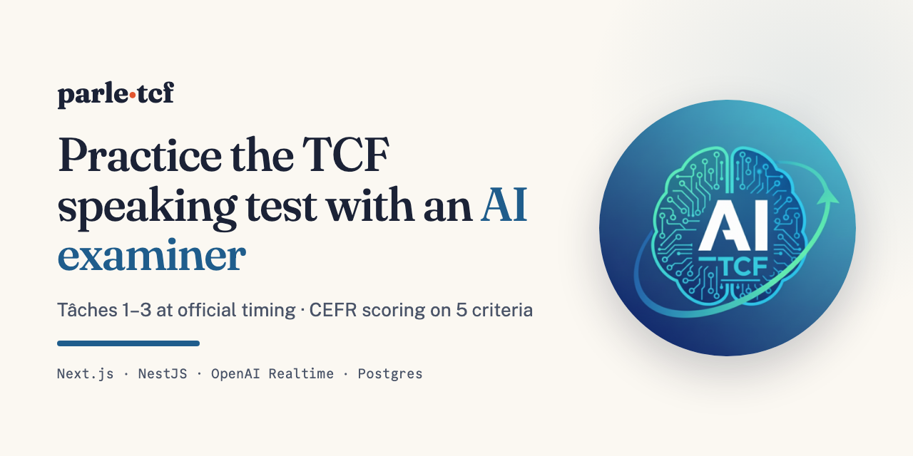
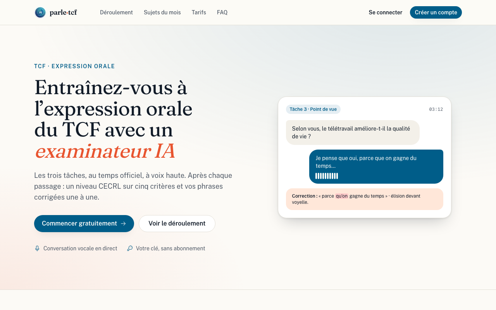
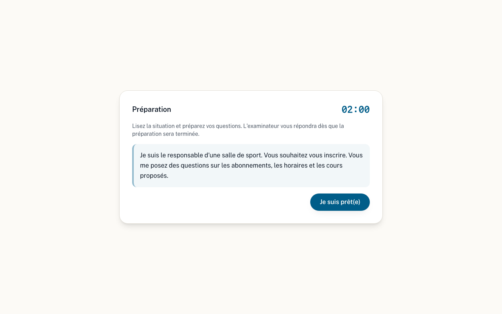
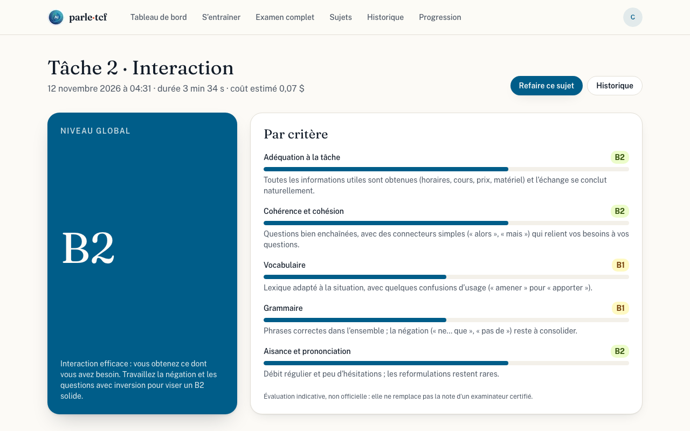
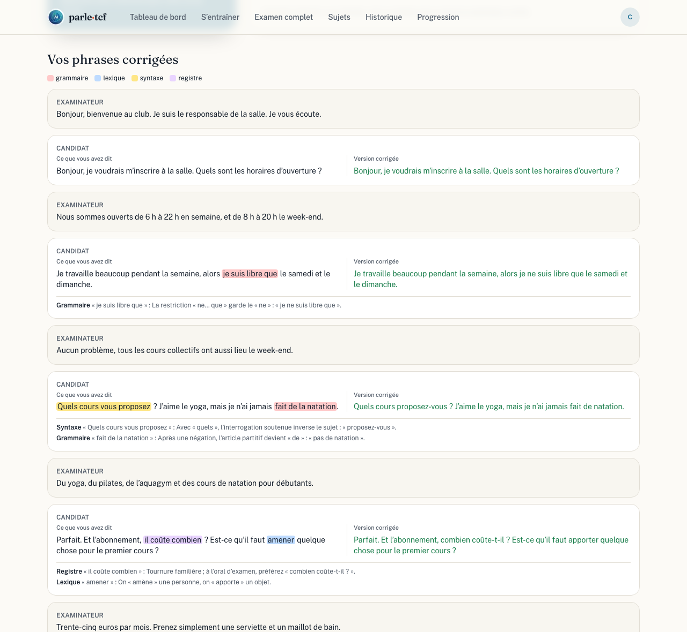
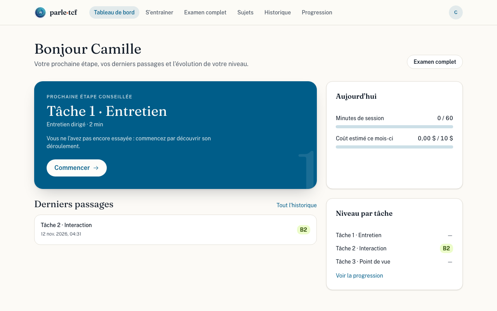
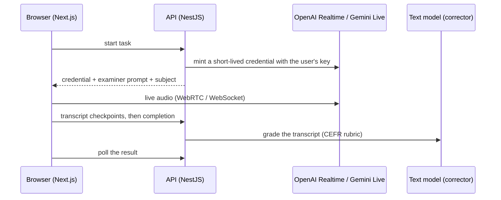

# parle-tcf

> 📖 **Case study:** [how and why I built it](https://yorty.info/projects/parle-tcf/) · Built by [Yorty Ruiz Hernandez](https://yorty.info)



**Practise the TCF speaking test with an AI examiner, then get a CEFR level, feedback per criterion and your corrected transcript.**

[](LICENSE)


[Screenshots](#screenshots) · [Features](#features) · [Quick start](#quick-start) · [How it works](#how-it-works) · [Documentation](docs/README.md) · [Contributing](#contributing)

parle-tcf simulates the three tasks of the TCF _expression orale_ with official timing. A real-time voice model plays the examiner in the browser (OpenAI Realtime or Gemini Live, with **your own API key**). When a task ends, a separate model grades the transcript on the CEFR scale (A1–C2), explains each criterion and corrects every sentence you said.

> [!IMPORTANT]
> **Not official.** parle-tcf is an independent practice tool. It is not affiliated with, endorsed by, or connected to France Éducation international, and the level it shows is an estimate, not a TCF score.

The app is in French; the code and documentation are in English.

## Screenshots

<table>
  <tr>
    <td width="50%"></td>
    <td width="50%"></td>
  </tr>
  <tr>
    <td align="center"><sub>Landing page</sub></td>
    <td align="center"><sub>Tâche 2: two minutes to prepare your questions</sub></td>
  </tr>
  <tr>
    <td width="50%"></td>
    <td width="50%"></td>
  </tr>
  <tr>
    <td align="center"><sub>CEFR level per criterion</sub></td>
    <td align="center"><sub>Every sentence corrected, errors typed and explained</sub></td>
  </tr>
  <tr>
    <td width="50%"></td>
    <td width="50%" valign="top">
      <br />
      <strong>Dashboard</strong>: the next task to practise, your latest attempts, today's minutes and this month's cost against your caps, and your level per task.
      <br /><br />
      <sub>Screenshots come from a local build in test mode (scripted voice session, sample subjects) with an illustrative evaluation. Regenerate them with <code>pnpm readme:images</code>.</sub>
    </td>
  </tr>
</table>

## The three tasks

| Task    | Format                                | Time                  |
| ------- | ------------------------------------- | --------------------- |
| Tâche 1 | Guided interview: introduce yourself  | 2 min                 |
| Tâche 2 | Role play: ask the examiner questions | 2 min prep + 3 min 30 |
| Tâche 3 | Argued opinion on a subject           | 4 min 30              |

Practise one task at a time or take the **full exam** in a row.

## Features

- **Timed like the exam:** each task runs on the official clock, and the examiner closes it when time is up.
- **A realistic examiner** that follows the format: it does not coach, finish your sentences or hint at answers, waits when you pause to find your words, and closes the task when time is up.
- **CEFR evaluation of every task:** global level, five criteria (task fulfilment, coherence, vocabulary, grammar, fluency) with a comment each, and an overall level for the full exam.
- **Corrected transcript:** each of your sentences with its errors highlighted by type (grammar, vocabulary, syntax, register), an explanation and a corrected version next to it.
- **Progress over time:** history, progression charts per task, side-by-side comparison of two attempts on the same subject, and a dashboard that suggests what to practise next.
- **Monthly exam subjects:** a bank of Tâche 2 and 3 subjects, searchable by month and keyword, kept up to date by an importer (the repository ships an original sample bank).
- **Your key, your costs:** API keys are encrypted at rest (AES-256-GCM) and never sent back to the browser. Costs are shown before and after each session, with daily and monthly caps (60 min a day and 10 USD a month by default).
- **Private by default:** optional audio recording only with explicit consent; deleting an attempt or the account deletes everything.

## Quick start

**Requirements:** [pnpm](https://pnpm.io/installation) and Docker (or Podman). pnpm installs the pinned pnpm version and the **Node.js LTS** the project uses by itself (`devEngines.runtime`); you do not need to install Node.js separately. To also get Node.js LTS as your global `node`, run `pnpm runtime set node lts -g`.

```bash
git clone https://github.com/yortyrh/parle-tcf.git && cd parle-tcf
pnpm install
pnpm infra:up        # Postgres + Mailpit + S3 storage, migrations, sample exercise bank
pnpm setup:env       # writes apps/api/.env and apps/web/.env.local
pnpm samples:seed    # dev users; passwords: pnpm local:credentials
pnpm dev             # web http://localhost:3000, api http://localhost:3001
```

1. Sign in as `developer@parle-tcf.local` with the password from `pnpm local:credentials`.
2. Add an [OpenAI](https://platform.openai.com/api-keys) or [Gemini](https://aistudio.google.com/apikey) API key in **Paramètres**.
3. Start a task from **S’entraîner**. Local emails (verification, password reset) land in Mailpit at http://localhost:8025.

To run the whole stack in containers instead: `cp .env.example .env`, fill in the secrets, then `docker compose up -d --build` (see [deployment](docs/deployment.md)).

### Configuration

`pnpm setup:env` writes a working local configuration; nothing else is required to try the app. Optional settings:

| What                    | How                                                                                                                                                     |
| ----------------------- | ------------------------------------------------------------------------------------------------------------------------------------------------------- |
| GitHub / Google sign-in | OAuth credentials of your own development apps in `apps/api/.env` ([accounts](docs/features/accounts.md#configuration))                                 |
| Other local ports       | `POSTGRES_PORT`, `MAILPIT_SMTP_PORT`, `MAILPIT_UI_PORT`, `STORAGE_PORT` before `pnpm setup:env` ([development](docs/development.md))                    |
| Real exam subjects      | `pnpm exercises:import` from the public monthly pages, or the private bank with `EXERCISE_DATA_TOKEN` ([exercise bank](docs/features/exercise-bank.md)) |
| Default voice models    | `OPENAI_REALTIME_MODEL`, `GEMINI_LIVE_MODEL` ([voice providers](docs/features/voice-providers.md))                                                      |

Every API variable is documented in [`apps/api/.env.example`](apps/api/.env.example).

### Common commands

| Command                 | What it does                                                                                |
| ----------------------- | ------------------------------------------------------------------------------------------- |
| `pnpm dev`              | Web and API in watch mode                                                                   |
| `pnpm verify`           | Format check, lint, typecheck, unit tests with coverage thresholds, build (run before a PR) |
| `pnpm test:integration` | API integration tests against Postgres and Mailpit in Testcontainers                        |
| `pnpm test:e2e`         | Playwright + axe against a production build with the fake voice provider (needs `infra:up`) |
| `pnpm mutate`           | Stryker mutation tests on the files changed against `origin/main`                           |
| `pnpm readme:images`    | Regenerates the README screenshots and the social preview (needs `infra:up`)                |
| `pnpm infra:down`       | Stops the local infrastructure (`pnpm infra:reset` also wipes its data)                     |

The full list, including the scaffolds that generate new API features, pages and packages, is in [development](docs/development.md) and [`CLAUDE.md`](CLAUDE.md#tooling-first-generate-then-edit).

## How it works



Audio never goes through the API, and the provider key never reaches the browser. The examiner runs on `gpt-realtime-2.1-mini` (OpenAI) or `gemini-3.8-live` (Gemini, experimental); the corrector is `gpt-6-luna` or `gemini-3.5-flash-lite`, matching the user's provider, with a versioned rubric checked by offline evals. Details: [architecture](docs/architecture.md), [evaluation](docs/features/evaluation.md).

### Repository layout

```text
apps/
  web/       Next.js app: pages, voice session in the browser (candidate-facing, in French)
  api/       NestJS API: auth, session minting, attempts, CEFR evaluation, usage limits, mail
  e2e/       Playwright end-to-end suite and the README screenshot capture
packages/
  db/              Drizzle schema, SQL migrations, sample exercise bank
  shared/          Zod schemas, API routes and types shared by web and API
  email-templates/ React Email templates
  importer/        Monthly exam subject importer
docs/        One page per feature, architecture, deployment, ADRs
```

## Tech stack

| Area       | Choice                                                                                      |
| ---------- | ------------------------------------------------------------------------------------------- |
| Web        | Next.js 16 (App Router), React 19, Tailwind CSS 4, shadcn/ui                                |
| Voice      | OpenAI Realtime (`@openai/agents`, WebRTC), Gemini Live (`@google/genai`, WebSocket)        |
| API        | NestJS 11, oRPC contract with Zod schemas, Better Auth (email, GitHub, Google)              |
| Grading    | Vercel AI SDK structured output, versioned CEFR rubric, offline evals                       |
| Data       | PostgreSQL, Drizzle ORM and SQL migrations, S3-compatible storage for optional audio        |
| Tooling    | pnpm 12, Turborepo, Node.js 26 LTS, TypeScript, ESLint, Prettier                            |
| Quality    | Vitest (unit, PGlite), Supertest + Testcontainers, Playwright + axe, Stryker mutation tests |
| Deployment | Docker images, Railway (API + web + importer cron)                                          |

## Documentation

All documentation lives in [`docs/`](docs/README.md), with one page per feature; [`llms.txt`](llms.txt) indexes it for LLM agents.

- [Architecture](docs/architecture.md) · [Development](docs/development.md) · [Deployment](docs/deployment.md) · [API reference](docs/api.md) · [Examiner prompts](docs/prompts.md)
- Features: [exam sessions](docs/features/exam-sessions.md), [voice providers](docs/features/voice-providers.md), [keys and settings](docs/features/provider-settings.md), [evaluation](docs/features/evaluation.md), [results and progress](docs/features/results-and-progress.md), [exercise bank](docs/features/exercise-bank.md), [accounts](docs/features/accounts.md), [usage limits](docs/features/usage-limits.md), [audio recording](docs/features/audio-recording.md), [website and email](docs/features/website.md)
- [Architecture decisions](docs/adr) · [Changelog](CHANGELOG.md) · [Product requirements](docs/prd.md) · [Contributor and agent rules](CLAUDE.md)

## Contributing

Issues and pull requests are welcome. Before opening a pull request:

1. Read [development](docs/development.md) and [`CLAUDE.md`](CLAUDE.md): scaffolds first, tests in their own commit before the code, [Conventional Commits](https://www.conventionalcommits.org/).
2. Run `pnpm verify` (format, lint, types, unit tests with coverage, build). For API or flow changes, also `pnpm test:integration` and `pnpm test:e2e`.
3. Keep candidate-facing text in French and everything else in English.
4. If the UI changes, refresh the screenshots with `pnpm readme:images`.

## Security

Please report vulnerabilities privately, as described in [SECURITY.md](SECURITY.md). Do not open a public issue.

## License

[MIT](LICENSE). The exam subjects and the TCF format belong to their respective owners; parle-tcf is not affiliated with France Éducation international.
