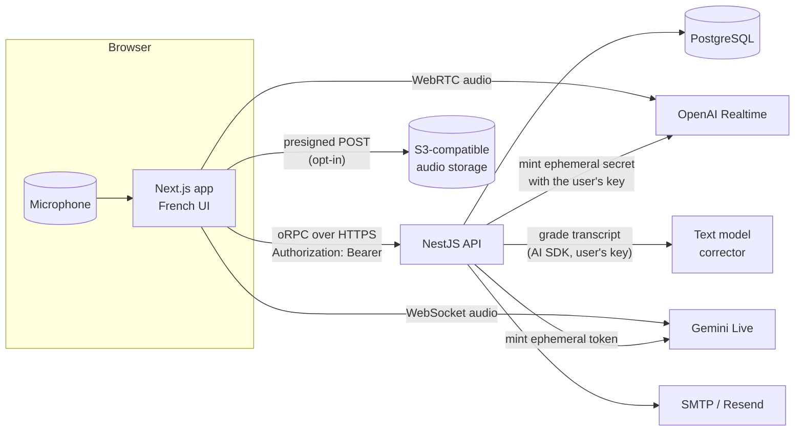

# Architecture

## Summary

parle-tcf is a pnpm + Turborepo monorepo. A Next.js web app runs the voice session **in the browser**, directly against the voice provider (OpenAI Realtime over WebRTC, or Gemini Live over WebSocket). A NestJS API never relays audio: it authenticates users, decrypts their own provider key to mint a short-lived credential, serves the exam content, stores attempts and transcripts, and grades each task with a separate text model.

## Packages

| Package                    | Role                                                                                                                                   |
| -------------------------- | -------------------------------------------------------------------------------------------------------------------------------------- |
| `apps/web`                 | Next.js 16 App Router UI (shadcn/ui, Tailwind 4). Voice session state in `providers/realtime-exam-provider.tsx`. French UI.            |
| `apps/api`                 | NestJS 11. Better Auth, oRPC contract, session minting, attempts, evaluation, usage limits, audio, mail.                               |
| `apps/e2e`                 | Playwright end-to-end tests with axe accessibility checks, against a fake voice provider.                                              |
| `packages/db`              | Drizzle schema, SQL migrations (including the exercise bank data), migration runner, PGlite test helper.                               |
| `packages/shared`          | Zod schemas, `TaskType`, `TASK_DURATIONS`, `API_ROUTES`, model defaults and prices. Built to `dist/`; dependents use the built output. |
| `packages/email-templates` | React Email templates (verification, password reset, account deletion).                                                                |
| `packages/importer`        | CLI that imports the monthly TCF subjects into the exercise bank (Railway cron).                                                       |

## Runtime components

## Voice session flow

1. The candidate picks a task (practice) or starts the full exam. The browser calls `POST /exam/session/create`.
2. The API, for the signed-in user only:
   - loads and decrypts the user's provider key (AES-256-GCM, `apps/api/src/crypto`);
   - checks the daily-minute and monthly-cost limits;
   - loads the task prompt (`apps/api/config/agents/tache*.yml`) and the exercise (PostgreSQL);
   - mints an ephemeral credential with the user's key (OpenAI `client_secrets`, or a single-use Gemini auth token);
   - creates an `in_progress` attempt and returns the credential, the instructions, the exercise and the agent settings.
3. For Tâche 2, the browser shows the situation for the 2-minute preparation, then asks `POST /exam/session/token` for a fresh credential (Gemini tokens must open a session within minutes) and the attempt clock starts.
4. The browser connects to the provider with the credential, sends the instructions and a "candidate is ready" message, and the examiner speaks first.
5. While the task runs, the browser saves the transcript every few seconds (`/attempts/checkpoint`, idempotent by line number) and shows a countdown. When time is up it tells the model, which says the closing line and calls the `finSession` tool.
6. The browser saves the final transcript and usage (`/attempts/complete`). The API closes the attempt once, computes the duration from its own clock and the cost from the token usage, then grades the transcript in the background.
7. The result page polls the attempt until the evaluation is `done` or `failed`.

The provider key never reaches the browser; the browser only holds the ephemeral credential. See [ADR 0004](./adr/0004-encrypted-user-keys.md) and [ADR 0005](./adr/0005-gemini-live-provider.md).

## Data model

All tables live in `packages/db/src/schema` (Drizzle); migrations in `packages/db/migrations`.

| Table                                        | Purpose                                                                                                  |
| -------------------------------------------- | -------------------------------------------------------------------------------------------------------- |
| `user`, `session`, `account`, `verification` | Better Auth (accounts, sessions, OAuth links, one-time tokens including the OAuth hand-off codes).       |
| `provider_settings`                          | One row per user: provider, encrypted key (ciphertext, IV, tag, key version), last 4, models, voice.     |
| `usage_limits`                               | Optional per-user overrides of the daily minutes and monthly cost caps.                                  |
| `user_preferences`                           | Non-credential preferences (audio recording consent).                                                    |
| `exercises`                                  | One row per distinct subject (task, text, scenario, instruction, image), deduplicated by `content_hash`. |
| `exercise_occurrences`, `exercise_sessions`  | Where and when each subject was published (month, part, position).                                       |
| `exercise_aliases`, `import_runs`            | Old ids of merged subjects; log of each import.                                                          |
| `exam_runs`                                  | A full exam (three tasks) with its overall level.                                                        |
| `exam_attempts`                              | One task attempt: mode, task, exercise, provider, model, status, timing, tokens, cost, audio key.        |
| `transcripts`                                | Ordered lines of an attempt (speaker, text), with the corrector's corrected text and errors.             |
| `evaluations`                                | Status, global level, per-criterion levels and comments, summary, corrector model, rubric version.       |

## Security model

- **User isolation lives in the API, not the database** (no row-level security). Every query filters by `user_id`; another user's row is indistinguishable from a missing one (`NOT_FOUND`). New queries come with a cross-user test.
- **Authentication:** Better Auth with the `bearer()` plugin. The web app is on another site, so it never relies on cookies: it stores the token from `set-auth-token` in `localStorage` and sends `Authorization: Bearer`. `SessionAuthGuard` accepts bearer only.
- **Secrets at rest:** provider keys are encrypted with AES-256-GCM, a random IV per write and versioned master keys outside the database (`ENCRYPTION_KEYS`), with an online rotation script.
- **Bundle boundary:** `apps/web/lib/web-bundle-security.test.ts` fails if web code imports server-only modules or secrets.
- **HTTP hardening:** helmet defaults, CORS allow-list (`CORS_ORIGINS`), per-client rate limit (`THROTTLE_LIMIT_PER_MINUTE`), structured logs with secret redaction (pino).

## Configuration files

| Path                                                 | Content                                                           |
| ---------------------------------------------------- | ----------------------------------------------------------------- |
| `apps/api/config/agents/tache{1,2,3}.yml`            | Examiner prompts per task (French). See [prompts](./prompts.md).  |
| `apps/api/config/info/questions-tache1-entretien.md` | Tâche 1 reference question bank appended to the prompt.           |
| `apps/api/config/français/rubrique-v1.md`            | Corrector system prompt (CEFR rubric v1).                         |
| `apps/api/config/service.yml`                        | Default voice and model for OpenAI sessions.                      |
| `apps/api/.env.example`, `apps/web/.env.example`     | Every environment variable, documented (`pnpm env-schema:check`). |

`apps/api/src/paths.ts` resolves the config directory from the API package or the monorepo root (Docker).
