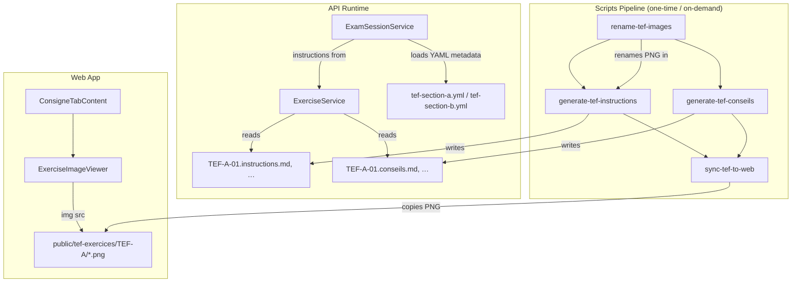

# TEF Exercise Pipeline Redesign

## Summary

Replace the prior TEF pipeline with:
- Standard images `TEF-{section}-{num}.png`
- **`TEF-*-NN.instructions.md`** — full Realtime system prompt (vision-generated body as JSON `prompt`, no shared prefix)
- **`TEF-*-NN.conseils.md`** — candidate-facing preparation guide (vision); not sent to the model
- Original images synced to the web app (`sync-tef`)
- Runtime loads split files from `tef-exercices/` (see `ExerciseService`)

## Architecture



## Script 1: `rename-tef-images`

- **Location**: `apps/api/scripts/rename-tef-images.ts`
- **npm script**: `"rename-tef": "tsx scripts/rename-tef-images.ts"`
- **Behavior**:
  - Reads `apps/api/config/tef-exercices/TEF-A/` and `TEF-B/`
  - Filters for `.png` files, sorts lexicographically
  - Renames by position: 1st file -> `TEF-A-01.png`, 2nd -> `TEF-A-02.png`, etc.
  - Dry-run by default; pass `--apply` to execute
  - Skips files already matching `TEF-{section}-\d{2}.png`
  - Old `.jpg` files are already deleted from disk (visible as "D" in git status); no action needed

## Script 2: `generate-tef-instructions`

- **Location**: `apps/api/scripts/generate-tef-instructions.ts`
- **npm script**: `"generate-tef-instructions": "tsx scripts/generate-tef-instructions.ts"`
- **Output**: `TEF-{section}-{num}.instructions.md` (exercise-specific markdown from the model only)
- **Flags**: `--force`, `--stub`, `--only`, `--model`
- Shared logic: `apps/api/scripts/tef-generation-shared.ts`

## Script 3: `generate-tef-conseils`

- **Location**: `apps/api/scripts/generate-tef-conseils.ts`
- **npm script**: `"generate-tef-conseils": "tsx scripts/generate-tef-conseils.ts"`
- **Output**: `TEF-{section}-{num}.conseils.md` (candidate preparation guide from vision; not sent to Realtime)
- **Flags**: `--force`, `--stub`, `--only`, `--model`

## Script 4: `sync-tef-to-web`

- **Location**: `apps/api/scripts/sync-tef-to-web.ts`
- **npm script**: `"sync-tef": "tsx scripts/sync-tef-to-web.ts"`
- **Behavior**:
  - Copies `TEF-{section}-{num}.png` files from `apps/api/config/tef-exercices/` to `apps/web/public/tef-exercices/`
  - Creates destination directories if needed
  - Does NOT copy `.md` files (those stay API-side)
  - Idempotent (overwrites existing files)

## API Changes

### `TefExercise` interface (`exercise.service.ts`)

```typescript
export interface TefExercise {
  id: string;           // "TEF-A-01"
  section: 'A' | 'B';
  filename: string;     // "TEF-A-01.png"
  instructions: string; // Full .instructions.md content (Realtime system prompt)
  practiceGuide: string | null; // From .conseils.md only (null if missing)
}
```

Removed fields: `title`, `annonce`, `consigne`, `generatedImagePath`, `generatedImagePaths`.

### `ExerciseService.loadTefExercises()`

- Scans `TEF-A/` and `TEF-B/` for `TEF-{section}-{num}.instructions.md`
- Reads each file as `instructions`; reads `TEF-{section}-{num}.conseils.md` as `practiceGuide` when present (else `null`)
- Pairs each exercise with `TEF-{section}-{num}.png`
- Caches in memory (lazy-loaded)

### `ExamSessionService.buildExerciseData()`

- For `tef-section-a` and `tef-section-b`: `content` = the `.instructions.md` text
- `description` = generic string per section ("Demande d'informations par telephone" for A, "Argumentation avec un(e) ami(e)" for B)

### `ExamSessionService.buildTefImagePayload()`

- Simplified: only `type`, `id`, `filename`, `section`
- No more `annonce`, `title`, `consigne`, `generatedImagePath`, `generatedImagePaths`

### `ExamSessionService.buildFullInstructions()`

- For TEF tasks, returns `*.instructions.md` verbatim (self-contained on disk).

## Shared Package Changes

### `ExerciseImagePayload` (`packages/shared/src/schemas/exam-session.ts`)

Simplified schema:
```typescript
{
  type: 'exerciseImage',
  id: string,
  filename: string,
  section: 'A' | 'B',
}
```

Removed: `annonce`, `title`, `consigne`, `generatedImagePath`, `generatedImagePaths`.

## Web Changes

### `ExerciseImageViewer` (`apps/web/components/app/exercise-image-viewer.tsx`)

- Remove overlay logic (markdown annonce, title/annonce text)
- Remove `useExerciseAnnonceMarkdown` hook usage
- Display image full-width with natural aspect ratio and vertical scroll:
  - Use `` or `next/image` with `width={0} height={0} sizes="100vw"` and `className="w-full h-auto"`
  - Container: `overflow-y-auto` for scrollability
- Remove badges overlay
- Image src: `/tef-exercices/TEF-{A|B}/{filename}`

### `ConsigneTabContent`

- Simplified TEF branch: just renders `ExerciseImageViewer` without consigne text

### `session-view.tsx`

- `mapExerciseImage()` simplified for the reduced payload shape

### `ExerciseImageData` type (`apps/web/types/exercise-image.ts`)

- Matches simplified `ExerciseImagePayload`

## Cleanup

### Files/directories to remove
- `apps/api/config/tef-exercises.json` (replaced by .md files)
- `apps/web/public/tef-exercices/generated/` (no more generated images)
- `apps/web/content/tef-annonces/` (100 .md files, no more annonce markdown)
- `apps/web/hooks/useExerciseAnnonceMarkdown.ts` (no more overlay markdown)
- `apps/web/app/api/tef-annonce/[id]/route.ts` (API route that served annonce markdown)

### Scripts to remove from `apps/api/package.json`
- `extract-tef` / `apps/api/scripts/extract-tef-exercises.ts`
- `generate-tef-images` / `apps/api/scripts/generate-tef-images.ts`
- `generate-tef-annonces` / `apps/api/scripts/generate-tef-annonces.ts`
- `clean-tef-dimension-images`
- `reset-tef-images`

### New scripts (`apps/api/package.json`)

- `"rename-tef": "tsx scripts/rename-tef-images.ts"`
- `"generate-tef-instructions": "tsx scripts/generate-tef-instructions.ts"`
- `"generate-tef-conseils": "tsx scripts/generate-tef-conseils.ts"`
- `"sync-tef": "tsx scripts/sync-tef-to-web.ts"`

## Constraints

- YAML files (`tef-section-a.yml`, `tef-section-b.yml`) keep general behavioral rules unchanged
- The exercise-specific block inside `*.instructions.md` is role, context, known info, consigne (from vision / manual edit)
- Images are shown as-is without text extraction or overlay
- The conversation starts immediately (Section A = phone call, Section B = friend conversation)
- After the exam and report, the agent switches to coaching mode (unchanged from current YAML)
